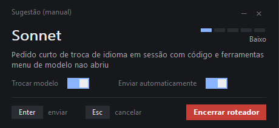

# Roteador de modelo e esforço para o Claude Desktop

Escolhe sozinho o **modelo** (Haiku, Sonnet, Opus) e o **nível de esforço** (Baixo, Médio, Alto, Extra, Max) do Claude Desktop antes de cada prompt, sem sair da interface. Funciona nos modos Chat, Cowork e Code.

> Projeto independente. Não é afiliado à Anthropic nem usa API paga: roda sobre a assinatura do Claude que você já tem.

## Como funciona

1. Você digita o prompt e aperta **Enter**.
2. O roteador lê o texto da caixa de prompt (UI Automation) e um resumo da conversa.
3. O **Haiku**, chamado pelo CLI `claude -p` da sua assinatura, classifica a tarefa e responde só `MODELO|ESFORÇO|MOTIVO`.
4. O roteador decide se **mantém ou troca** e muda o seletor do Claude Desktop (cliques por UI Automation).
5. Um cartão mostra a decisão. **Enter** envia, **Esc** cancela. Com a chave "Enviar automaticamente", o prompt segue sozinho depois de 3 s.

<p align="center">
  
</p>

### Regra de decisão (manter ou trocar)

Trocar modelo ou esforço no meio de uma conversa faz o histórico ser relido, o que custa mais. Por isso:

- Conversa nova: usa o ideal indicado pelo Haiku.
- Ideal **mais forte** que o atual: sobe na hora.
- Ideal **mais fraco**: mantém e conta os prompts seguidos pedindo menos. Só desce no `SEQ_PARA_TROCAR`-ésimo (padrão 4), ou depois de uma pausa maior que `CACHE_MIN` minutos (o cache do histórico já expirou).
- A contagem é **por conversa** (identificada pelo título da sessão) e fica só na memória.
- **Max** nunca é aplicado sozinho (custa várias vezes mais): o cartão aplica Extra e oferece o botão "Usar Max neste prompt".

## Requisitos

- Windows 10 ou 11 e PowerShell 5.1.
- [AutoHotkey v2](https://www.autohotkey.com/).
- Claude Desktop, aberto com `--force-renderer-accessibility` (sem isso a árvore de UI não é exposta).
- Claude CLI (`claude`) instalado, no PATH e logado na mesma conta do Desktop. Confira com `claude` e `/status`.

## Uso

1. Abra o Claude Desktop com `--force-renderer-accessibility`.
2. Dê dois cliques em `roteador.ahk`.
3. Use o Claude normalmente. `Ctrl+Alt+R` liga e desliga. O ícone da bandeja tem o log de uso e "Sair".

No cartão: **–** minimiza, **×** fecha, e as chaves ligam ou desligam a troca automática de modelo e o envio automático (o estado é lembrado).

## Configuração

No topo do `roteador.ahk`: `SEQ_PARA_TROCAR`, `CACHE_MIN`, `AUTO_ESPERA_SEG`, `LOG_MAX`, `MAX_CONVERSAS`, limites de tempo e cores. O guia do classificador está na variável `GUIA`.

## Privacidade e segurança

- Os prompts e o contexto vão só para a Anthropic, pelo CLI da sua conta. Nenhum serviço de terceiros.
- A chamada do Haiku roda sem ferramentas, sem MCP, sem hooks e sem salvar sessão, com telemetria não essencial desligada.
- O prompt é lido pela tela, não pela área de transferência (que só é usada se a tela não expuser o texto).
- A resposta do Haiku só é aceita se for um modelo e esforço conhecidos.
- Arquivos temporários com texto são apagados logo após o uso.
- O log `dados/uso-haiku.csv` guarda só números e estados (sem texto), limitado a `LOG_MAX` linhas.
- Os scripts `.ps1` rodam com `ExecutionPolicy Bypass`: não deixe a pasta em local compartilhado ou gravável por terceiros.

## Limitações

- Depende dos nomes dos controles do Claude Desktop **em português** (por exemplo `Modelo:`, `Mensagens da conversa`, `renomear sessão`). Em outro idioma ou versão, use `ferramentas/diagnostico-ui.ps1` e `ferramentas/achar-conversa.ps1` para descobrir os nomes e ajuste os scripts.
- Troca o modelo por cliques simulados: o cursor se mexe por um instante, e uma atualização do app pode quebrar.
- Preços e comportamento de cache mudam; revise `SEQ_PARA_TROCAR`.

## Teste manual

1. Conversa nova, prompt simples ("traduza para inglês: bom dia"): deve escolher Haiku/Baixo e aplicar na tela.
2. Prompt de código: nunca Haiku.
3. Conversa em andamento: pedidos mais simples mantêm o modelo até o `SEQ_PARA_TROCAR`-ésimo seguido.
4. Prompt muito complexo: Max não é aplicado sozinho, aparece o botão "Usar Max neste prompt".
5. Desligue a chave "Trocar modelo": o cartão só sugere. Esc cancela e o Enter volta ao normal.

## Estrutura

```
roteador-claude/
├── roteador.ahk              # programa principal: Enter, decisão, cartão, log
├── scripts/
│   ├── mudar-modelo.ps1      # troca modelo e esforço na tela
│   └── contexto.ps1          # lê modelo atual, título e últimas mensagens
├── ferramentas/              # só para adaptar o projeto a outra versão/idioma
│   ├── diagnostico-ui.ps1    # lista os controles da janela
│   └── achar-conversa.ps1    # mostra o que identifica a conversa aberta
├── docs/                     # imagens do README
├── dados/                    # criada sozinha; posição do cartão e log de uso (não vai ao Git)
├── LICENSE
└── README.md
```

As ferramentas gravam a saída em `%TEMP%`. Ela pode conter nomes de conversas: apague e não publique.

## Licença

MIT. Veja `LICENSE`.
